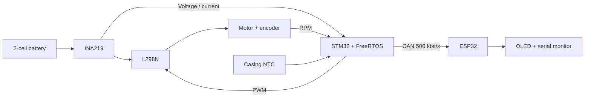

# CAN-Based Motor Health Monitoring

**STM32 + FreeRTOS · CAN bus · ESP32 · OLED**

A working bench prototype that monitors a geared DC motor and reports possible overload, near-stall, low supply voltage, high casing temperature and invalid sensor readings. The STM32 measures and evaluates motor behavior; an ESP32 receives measurements and warning flags over CAN and displays them on an OLED and serial monitor.

**Core idea:** a motor that slows while drawing more current may be encountering abnormal mechanical resistance. The warning requires both conditions to persist; one high-current sample alone does not mean overload.

## System at a glance

| Component | Purpose |
|---|---|
| STM32F103RB | Sensor acquisition, PWM motor control, fault evaluation and CAN transmission |
| Motor + encoder | Geared test motor and RPM feedback |
| INA219 | High-side current and voltage at the L298N supply input |
| NTC thermistor | Approximate motor-casing temperature |
| L298N and two 18650 cells in series | Motor drive and battery supply |
| ESP32 + 128 × 64 I²C OLED | CAN reception, live values and warning display |

The INA219 reports **driver-input bus voltage**, not voltage directly across the PWM-driven motor. The NTC is taped to the casing, not placed in the winding.

## Firmware and CAN

FreeRTOS separates sensor acquisition (`SensorTask`), warning evaluation (`FaultTask`), CAN transmission (`CANTask`) and motor control (`MotorTask`). Queues transfer sensor samples between tasks. This keeps the responsibilities organized; no speed comparison with a single-loop design was performed.

Two standard CAN frames were used in the demonstration at **500 kbit/s**:

| ID | Payload |
|---|---|
| `0x100`, 8 bytes | Signed big-endian 16-bit values: RPM × 10, current (A) × 1000, bus voltage (V) × 100, temperature (°C) × 10 |
| `0x101`, 3 bytes | Fault bits, commanded duty percentage, overload-rule availability |

The ESP32 prints status changes, updates the OLED and marks missing sensor or status frames as stale after roughly 1.5 seconds.

## Warning logic

| Warning | Trigger | Clears when | Validation |
|---|---|---|---|
| Overload at 50% duty | RPM < 85 **and** current > 0.34 A for 1 s | RPM > 90 and current < 0.32 A for 1 s | Real load and release |
| Overload at 75% duty | RPM < 112 **and** current > 0.33 A for 1 s | RPM > 116 and current < 0.32 A for 1 s | Real load and release |
| Near-stall at 50% duty | RPM < 20 and filtered current > 0.45 A for 0.5 s | RPM > 40 | Severe load and release; shaft still turned |
| Low supply voltage | Bus voltage < 6.4 V for 2 s | Voltage > 6.6 V | Warning path exercised with temporary values |
| High casing temperature | NTC > 60 °C for 2 s | NTC < 55 °C | Warning path exercised with temporary values |
| Sensor error | Invalid or missing sample | Valid-data recovery in later demo firmware | Error handling implemented; final flashed revision to confirm |

There is **no calibrated overload rule at 100% duty**. Battery and temperature warning limits are provisional. The 60 °C casing value is not a manufacturer-qualified motor limit.

## Results from the bench motor

Selected readings from one **50% duty** load-and-release run:

| Condition | RPM | Current | INA219 bus voltage |
|---|---:|---:|---:|
| Freely rotating | 99.3 | 0.275 A | 7.58 V |
| Loaded | 42.4 | 0.426 A | 7.09 V |
| Severe restriction | 12.7 | 0.710 A | 7.18 V |
| Released | 99.9 | 0.195 A | 7.54 V |

The overload warning appeared with sustained load and cleared after release. A stronger restriction produced the near-stall warning. Load and recovery were also demonstrated at 75% duty. These are **observations from hand-applied bench tests**, not repeatable torque measurements or a quantified accuracy study.

At one running point, INA219 measured about **7.50 V** and a multimeter about **7.53 V** at the driver input. Earlier implausible readings revealed a firmware defect: I²C read results had not been checked before interpreting the returned bytes. The driver was revised to reject failed reads. That one comparison is not full calibration, and the physical source of every disturbance was not conclusively identified.

## Proposed use case

A **power-window motor** can encounter extra resistance in its guide rail or regulator. A drop in RPM accompanied by increased current could be sent over CAN as a diagnostic warning. This prototype demonstrates that sensing-and-warning concept using a bench motor.

It was **not tested in a car window**. It does not stop or reverse the mechanism, measure pinch force, or provide automotive anti-pinch protection. Any vehicle application would need new thresholds, mechanism testing and independent safety validation.

## Repository status and next steps

The STM32 project is built in STM32CubeIDE using HAL and FreeRTOS. The ESP32 demonstration uses ESP-IDF, TWAI reception and I²C OLED output.

**Source-code note:** The STM32 files currently committed here are an **older snapshot**: `FaultTask` is still a placeholder and only the `0x100` telemetry frame is transmitted. The later warning logic, `0x101` frame and ESP32 OLED firmware used for the demonstration still need to be committed. The current repository commit alone does not reproduce the full demo.

The next useful steps are to synchronize both firmware projects, add dated test data and hardware photos, and repeat loading with a controlled mechanism across battery voltages. ML would require a substantially larger labeled dataset collected under repeatable conditions.

